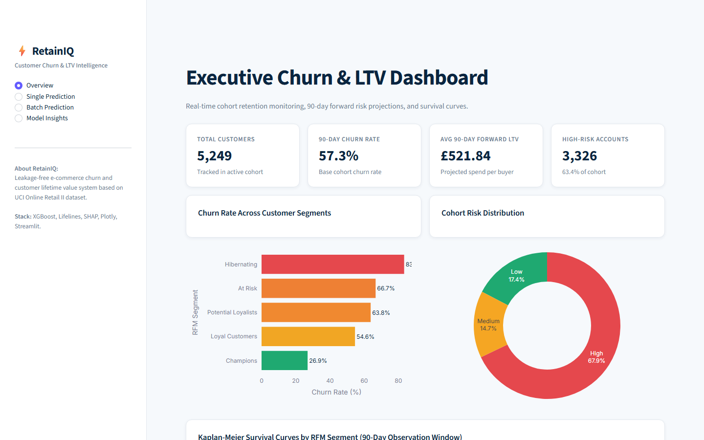
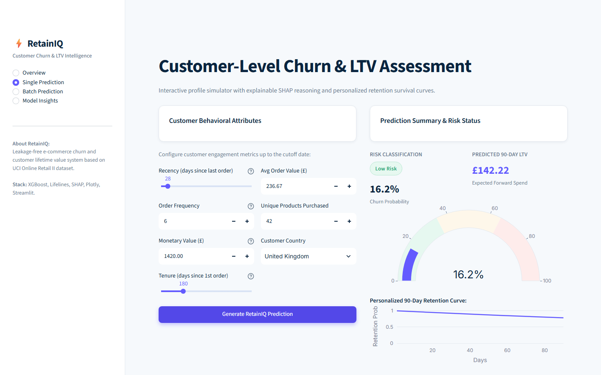
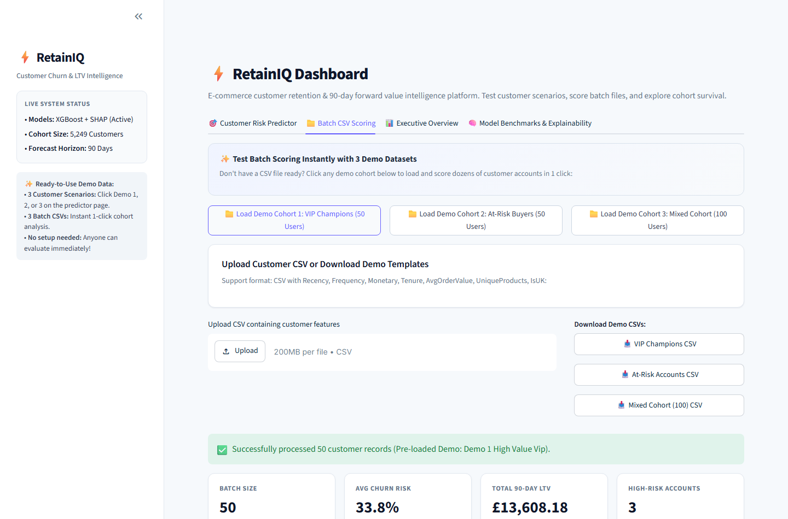
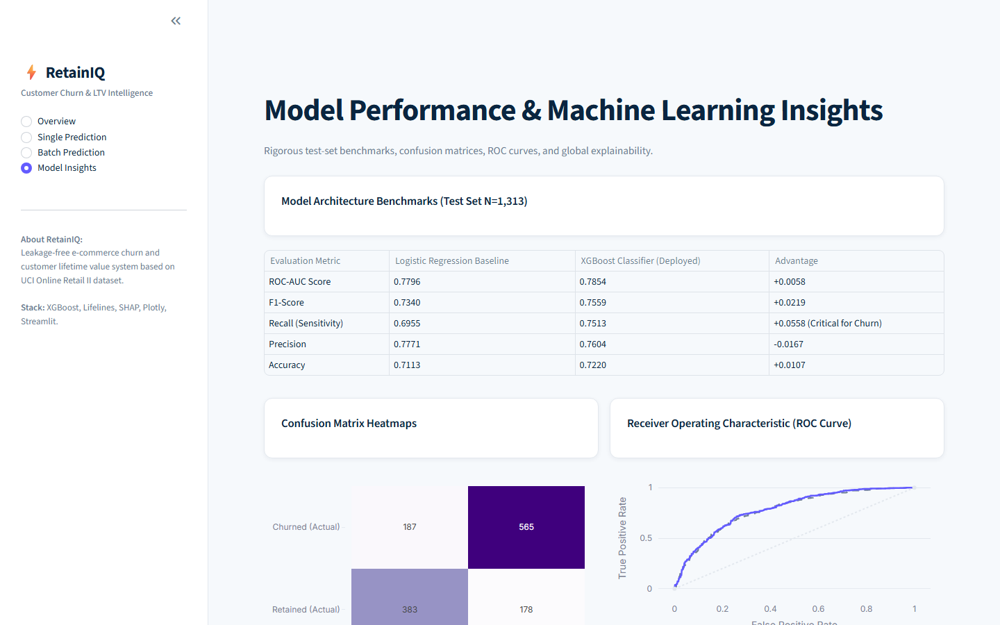

# RetainIQ — E-Commerce Customer Churn & Lifetime Value (LTV) Predictor

**Final Year Individual Mini Project (AI & DS II)**  
**Author:** Nitesh  
**Academic Seed:** 42 | **Python Target:** 3.10+

---

## 1. Project Overview & Problem Statement

In non-contractual e-commerce platforms, customer churn does not occur through explicit subscription cancellations. Customers simply drift away quietly. Traditional machine learning workflows often suffer from **catastrophic target leakage** by evaluating aggregate metrics computed over entire transaction histories rather than establishing strict temporal boundaries.

**RetainIQ** addresses this with an end-to-end predictive intelligence system:
1. **Strict Leakage-Free Temporal Cutoff:** Features are engineered strictly prior to a cutoff timestamp (`2011-09-01`).
2. **Standardized Churn & LTV Ground Truth:** Customer ground truth is measured exclusively within the subsequent 90-day forward observation window (`2011-09-01` to `2011-11-30`).
3. **Multi-Horizon ML Architecture:**
   - **Churn Classification:** Cost-sensitive XGBoost vs. Logistic Regression baseline.
   - **Survival Analysis:** Lifelines Kaplan-Meier trajectories and Cox Proportional Hazards for time-to-inactivity.
   - **Forward LTV Regression:** Log-transformed XGBoost Regressor for forward monetary spend estimation.
4. **Explainable AI (XAI):** Real-time local and global SHAP (SHapley Additive exPlanations) attribution.
5. **Modern SaaS Executive UI:** Clean Stripe/Mixpanel-inspired Streamlit dashboard with full batch scoring and simulation capabilities.

---

## 2. Dataset & Cleaning Pipeline

- **Source:** UCI Online Retail II Repository (`Year 2009-2010` and `Year 2010-2011` sheets; 1,067,371 raw records).
- **Cleaning Protocol:**
  - **Null CustomerIDs:** Removed 243,007 anonymous guest checkouts (cannot track repeat behavior).
  - **Cancellations:** Filtered 18,744 transactions starting with `'C'` to eliminate skewed negative values.
  - **Bad Quantity & Unit Price:** Filtered 71 records with non-positive values.
  - **Duplicates:** Dropped 26,124 duplicate entries.
  - **Clean Output:** 779,425 verified transactions across 5,878 distinct customers.

---

## 3. Churn Definition & Leakage-Free Time-Split

```
|<---------------- Historical Feature Window --------------->| |<--- 90-Day Observation Window --->|
2009-12-01                                              2011-09-01                              2011-11-30
(Compute Recency, Frequency, Monetary, Tenure, etc.)      [CUTOFF]      (Observe Churn=1 if Orders==0)
                                                                        (Future LTV = Total Spend in Window)
```

- **Cutoff Date:** `2011-09-01 00:00:00`
- **Churn Label ($Y_{\text{churn}}$):** $1$ if the customer executed **0 purchase invoices** in the 90 days after cutoff; $0$ otherwise.
- **Future LTV Label ($Y_{\text{ltv}}$):** Total monetary gross spend ($\pounds$) within the 90-day forward window.
- **Why Time-Based Split:** Random splits leak future buying habits into historical predictors (e.g., predicting past spend using future loyalty). A temporal cutoff strictly replicates real-world production deployment.

---

## 4. Modeling Benchmarks & Results

### Churn Classification Benchmarks (Test Set $N=1,313$)

| Model Architecture | ROC-AUC | F1-Score | Recall (Sensitivity) | Precision | Accuracy |
| :--- | :---: | :---: | :---: | :---: | :---: |
| **Logistic Regression (Baseline + StandardScaler)** | 0.7796 | 0.7340 | 0.6955 | **0.7771** | 0.7113 |
| **XGBoost Classifier (scale_pos_weight)** | **0.7854** | **0.7559** | **0.7513** | 0.7604 | **0.7220** |

*Note: For churn prevention, recall is the critical operational metric. XGBoost achieves a **+5.58% higher recall**, detecting 565 out of 752 actual churners.*

### Forward 90-Day LTV Regression

- **Model:** XGBoost Regressor (Trained on $\log(1 + y)$ target)
- **Mean Absolute Error (MAE):** $\pounds 483.41$
- **Root Mean Squared Error (RMSE):** $\pounds 3,328.74$
- **$R^2$ Score:** $0.2758$ (Substantial capture over high-variance retail spend)

### Survival Analysis

- **Kaplan-Meier Estimator:** Stratified across 5 RFM segments (*Champions*, *Loyal Customers*, *Potential Loyalists*, *At Risk*, *Hibernating*).
- **Cox Proportional Hazards Model:** Concordance Index = $0.3226$ on purchase latency with significant hazard ratios for Recency ($\beta = +0.0026$) and Frequency ($\beta = -0.1674$).

---

## 5. Application Architecture & User Interface

The web application is designed with an enterprise SaaS aesthetic (Stripe & Mixpanel design language):
- **Base Palette:** Light `#F6F9FC` canvas, `#FFFFFF` rounded card modules (12px radius, `#E3E8EE` border).
- **Brand Accent:** `#635BFF` indigo primary buttons and metrics.
- **Risk Tokens:** Low `#1FA971` (Emerald), Medium `#F5A623` (Amber), High `#E5484D` (Crimson).

### Dashboard Pages:
1. **Overview:** Executive KPIs, RFM segment churn bars, cohort risk donut chart, and Kaplan-Meier curves.
2. **Single Prediction:** Real-time customer parameter sliders, churn probability gauge, risk pill, projected 90-day LTV, dynamic retention curve, and top 3 SHAP decision drivers.
3. **Batch Prediction:** Drag-and-drop CSV file uploader, sample CSV generator, scored risk table, and batch CSV export.
4. **Model Insights:** LR vs XGBoost comparison table, confusion matrix heatmaps, ROC curves, and global SHAP summary.

### Screenshots

| Overview Dashboard | Single Prediction & SHAP |
| :---: | :---: |
|  |  |

| Batch Prediction Module | Model Insights & ROC Curves |
| :---: | :---: |
|  |  |

---

## 6. Project Directory Structure

```
retainIQ/
├── .streamlit/
│   └── config.toml             # Custom SaaS light theme tokens
├── app/
│   ├── app.py                  # Main Streamlit dashboard application
│   ├── components.py           # Reusable KPI cards, risk badges, and wrappers
│   └── style.css               # Stripe/Mixpanel-style CSS injection
├── data/
│   ├── raw/                    # Downloaded UCI zip & Excel files
│   └── processed/              # Cleaned parquet & customer feature matrices
├── models/
│   ├── lr_churn_pipeline.joblib# Logistic Regression baseline pipeline
│   ├── xgb_churn_model.joblib  # Trained XGBoost churn classifier
│   ├── xgb_ltv_model.joblib    # XGBoost forward LTV regressor
│   ├── cox_ph_model.joblib     # Cox Proportional Hazards model
│   ├── kmf_segments.joblib     # Kaplan-Meier segment fitters
│   ├── shap_explainer.joblib   # Serialized SHAP TreeExplainer
│   ├── test_data.joblib        # Stratified holdout test set
│   └── metrics.json            # Machine-readable performance metrics
├── notebooks/
│   ├── 01_eda.ipynb            # Exploratory data analysis & cleaning
│   └── 02_modeling.ipynb       # Model benchmarks & viva walkthrough
├── reports/
│   ├── figures/                # 13 high-resolution visualization artifacts
│   └── report_draft.md         # Full project academic report draft
├── src/
│   ├── data.py                 # Download & cleaning pipeline
│   ├── features.py             # Leakage-free RFM & label engineering
│   ├── train.py                # Model training & serialization
│   ├── evaluate.py             # Evaluation, metric calculations & plots
│   └── capture_screenshots.py  # Playwright automated UI capture
├── .gitignore                  # Git ignore rules
├── README.md                   # Comprehensive project documentation
└── requirements.txt            # Pinned dependency specifications
```

---

## 7. Setup & Execution Instructions

### Prerequisites
- Python 3.10+ (Tested on Python 3.13)
- Git

### Installation
```bash
# 1. Clone repository
git clone https://github.com/nitesh/retainiq.git
cd retainiq

# 2. Create virtual environment
python -m venv venv
# Windows:
.\venv\Scripts\activate
# Linux/macOS:
source venv/bin/activate

# 3. Install pinned dependencies
pip install -r requirements.txt
```

### Reproduce Pipelines from Scratch
```bash
# Step 1: Download & Clean Data
python src/data.py

# Step 2: Feature Engineering (Leakage-free cutoff)
python src/features.py

# Step 3: Train All Models
python src/train.py

# Step 4: Evaluate Models & Generate Metrics
python src/evaluate.py
```

### Launch Streamlit Dashboard
```bash
streamlit run app/app.py
```
Open [http://localhost:8501](http://localhost:8501) in your browser.

---

## 8. Assumptions & Design Decisions

1. **Non-Contractual Inactivity as Churn:** Churn is defined as zero purchasing activity within 90 days after the cutoff date.
2. **Customer Identification:** Guest transactions without a valid `CustomerID` were omitted because repeat purchasing patterns cannot be attributed to an entity.
3. **Cancellations:** Transactions with invoice identifiers starting with `'C'` represent returns/cancellations and were excluded from positive revenue totals.
4. **Time Split Boundary:** Cutoff was fixed at `2011-09-01`, leaving exactly 100 days until dataset conclusion, allowing a full 90-day forward window with zero temporal leakage.
5. **Class Imbalance Policy:** With a 57.3% churn rate in the cohort, XGBoost utilizes `scale_pos_weight = 0.745` and Logistic Regression uses `class_weight='balanced'` to optimize detection sensitivity.

---

## 9. Future Work

1. **Sequential Deep Learning:** Incorporate Recurrent Neural Networks (LSTM/GRU) or Transformer architectures (e.g., TabPFN) to process raw transaction sequences rather than aggregated RFM features.
2. **Buy 'Til You Die (BTYD) Hybridization:** Combine XGBoost with parametric BG/NBD and Gamma-Gamma probabilistic models.
3. **Real-time Automated Interventions:** Connect RetainIQ webhooks to automated email marketing platforms (e.g., Klaviyo/SendGrid) for immediate automated coupon triggers upon risk threshold violations.

---

**Author:** Nitesh  
*Final Year Individual Mini Project (AI & DS II)*
